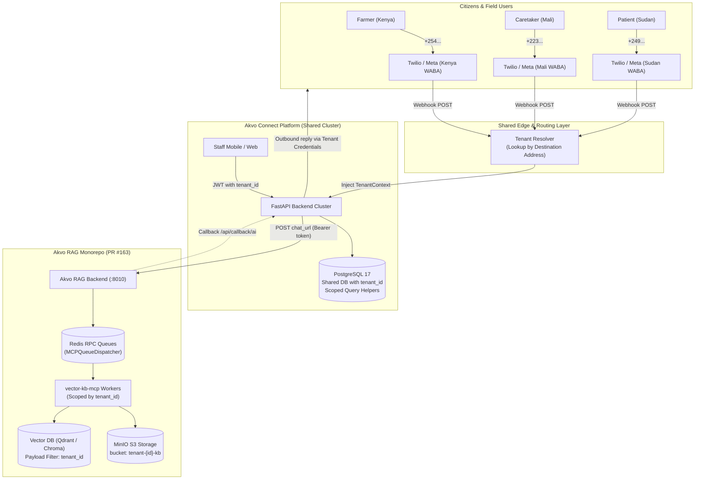
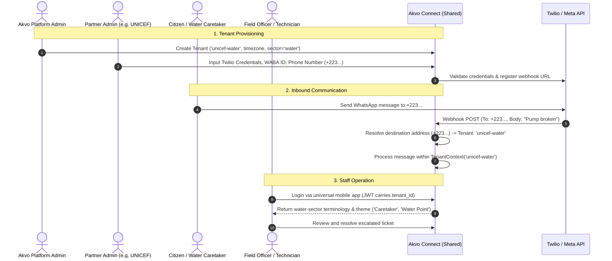
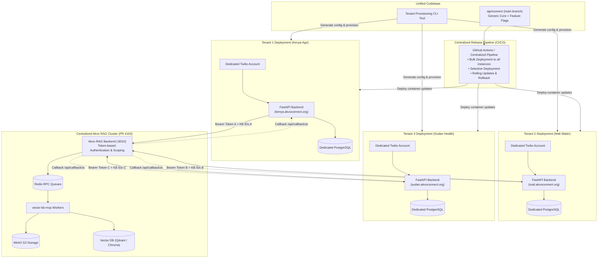
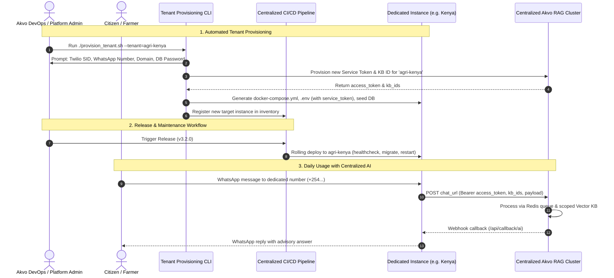

# Akvo Connect – Technical Summary & Architectural Proposal

**Context:** Discussion between Galih & Deden | 13 October 2026  
**Status:** Completed Proposal & Evaluation Draft  
**Target Systems:** AgriConnect (`backend`, `frontend`, `app`), Akvo RAG (`akvo/akvo-rag` - `epic/rag-monorepo-mcp` / PR #163)

---

## Executive Summary

The objective of this document is to establish a clear architectural roadmap for transforming **AgriConnect** from an agriculture-specific, single-tenant deployment into **Akvo Connect**—a generic, sector-agnostic advisory platform that can serve multiple organizations across Agriculture, Public Health (Johns Hopkins University), and Water/WASH (UNICEF, WaterNet).

Following our architectural discussions:
1. **Existing Technical Debt** (including consolidating agriculture branches and migrating to the newly consolidated **Akvo RAG Monorepo PR #163**) must be addressed as Step 0.
2. **Each tenant must maintain its own distinct WhatsApp number** for organizational identity, partner credibility, and regulatory compliance. Therefore, the hypothetical concept of sharing a single WhatsApp number across organizations has been **dismissed**.
3. Two concrete architectural models are evaluated:
   - **Option 1: Shared Multi-Tenant Architecture** (One deployment, shared database with `tenant_id` isolation, edge channel resolution).
   - **Option 2: Independent Deployment per Tenant** (Dedicated deployments per tenant, unified codebase on `main`, interactive provisioning CLI, and centralized CI/CD).

---

## 1. Existing Technical Debt (Prerequisite Cleanup)

Before expanding to new sectors or provisioning additional organizations, the following technical debt must be resolved on `main`.

### 1.1 Akvo RAG Monorepo Migration (`akvo/akvo-rag` PR #163)

The new Akvo RAG architecture developed in branch `epic/rag-monorepo-mcp` (PR #163) modernizes the AI engine but has not yet been connected to AgriConnect:

* **Key PR #163 Changes:**
  - Consolidated vector microservices into a unified monorepo.
  - Eliminated Celery & RabbitMQ in favor of native asynchronous **Redis Request-Reply queues** with `correlation_id` via `MCPQueueDispatcher`.
  - Added dedicated workers: `vector-kb-mcp` (Query RPC) and `vector-kb-mcp-ingestion` (Document parsing & chunking).
  - Modernized data layer to **PostgreSQL 17** (`asyncpg` with dedicated `alembic_version_vkb`), **MinIO S3** (`:9010`) for raw files/images, and ChromaDB (`:8002`) with SQLite WAL mode.
* **Migration Requirements:**
  1. **Update Akvo RAG Manifests & Deployment:** Modify `akvo-rag` deployment manifests, Docker Compose, and infrastructure orchestration to support the new 8-container topology (Redis, MinIO, dual workers, PostgreSQL 17).
  2. **Transition Backend Integration:** Update AgriConnect's legacy `ExternalAIService` to communicate with the Redis-backed RPC interface.
  3. **Develop KB Migration & Ingestion Pipeline Script (RAG-02):** Because there is currently no automated script to extract and structure legacy Knowledge Bases, a migration and re-ingestion tool must be built to:
     - Connect to legacy storage and download all existing documents.
     - Folderize files cleanly by `KB Name` and map them to their corresponding `KB ID`.
     - Re-upload raw files into the new MinIO S3 bucket (`tenant-{id}-kb`).
     - **Re-execute the complete Data Ingestion Pipeline:** Dispatch parsing/chunking tasks to the new `vector-kb-mcp-ingestion` Redis queue worker, generate dense embeddings, populate the new vector collections in Chroma/Qdrant, and monitor/verify asynchronous callback status (`/api/callback/kb`) until index readiness is confirmed.
  4. **Integration & Regression Testing:** Validate webhook callback schemas (`/api/callback/ai` and `/api/callback/kb`) against the new monorepo.

### 1.2 Comprehensive Inventory of Agriculture-Specific Code & Artifacts

Beyond the high-level onboarding and escalation notes, an in-depth codebase audit reveals deep-rooted agricultural coupling across all layers:

#### A. Database Schema & ORM Models
* **`models/user.py`:** Role enum `UserType` currently hardcodes `EXTENSION_OFFICER = "eo"`. Rather than creating separate sector-specific user roles (e.g., CHW, Water Technician), **this role will be consolidated into a single General User Type** (e.g., `OFFICER` or `STAFF` / `FIELD_OFFICER`) for all tenant sectors. Operational staff across agriculture, water, and health perform the exact same workflows (responding to escalated tickets, broadcasting announcements, viewing assigned geographic jurisdictions). Any sector-specific naming differences are purely cosmetic and handled via tenant display configuration (`officer_label: {"en": "Health Worker"}`).
* **`models/customer.py`:** The `Customer` model contains a hardcoded Python property `@property def crop_type(self)`.
* **`models/weather_broadcast.py`:** The database table `weather_broadcasts` explicitly includes a `crop_type` column (`Column(String(100))`), and broadcast recipients are grouped strictly by `(administrative_id, crop_type)`.

#### B. API Endpoints & Routers
* **`routers/crop_types.py`:** An entire dedicated API router (`GET /api/crop-types`) exists solely to serve crop lists from configuration.
* **`routers/statistic.py`:** Endpoints hardcode agricultural entity paths and Pydantic schemas:
  - `GET /api/statistic/farmers/stats` (`FarmerStatsResponse`)
  - `GET /api/statistic/farmers/stats/by-ward` (`FarmerStatsByWardResponse`)
  - `GET /api/statistic/farmers/registrations`
  - `GET /api/statistic/aggregate/farmers` (`FarmerAggregateResponse`)
  - `GET /api/statistic/crops/distribution` (`CropDistributionResponse`)
  - `GET /api/statistic/crops/distribution/matrix` (`CropDistributionMatrixResponse`)
* **`routers/user_stats.py`:** Officer metrics return `farmers_reached` instead of generic `beneficiaries_reached` or `citizens_reached`.
* **`routers/customers.py`:** The CSV export handler explicitly hardcodes `"Crop Type"` as a CSV column header and extracts `customer.crop_type`.

#### C. Backend Services & Business Logic
* **`services/statistic_service.py`:** Over 600 lines of query logic filtering on `Customer.profile_data.op("->>")("crop_type")` and computing farmer metrics (`active_farmers`, `dormant_farmers`, `farmers_with_questions`, `farmers_who_escalated`, `avg_questions_per_farmer`).
* **`services/onboarding_service.py`:** Contains dedicated AI crop extraction methods (`_normalize_crop_name`, `_build_crop_identification_prompt`, `resolve_crop_ambiguity`, `_format_crops_numbered`, `_get_crop_by_number`) and multiple explicit `if field_name == "crop_type":` branches.
* **`services/follow_up_service.py`:** Hardcoded English and Swahili system prompts instructing OpenAI: *"You are a helpful agricultural assistant. A farmer has just asked a question... What specific crop or livestock is affected?"*, along with the `FarmerContext` dataclass.
* **`utils/conversation_summary.py`:** `get_customer_context()` extracts `"farmer_id"` and `"crop"`.
* **`utils/i18n.py`:** Dedicated helper `get_crop_name_translated()`.

#### D. Prompts, Locales, and Email Templates
* **`templates/invitation.html` & `.txt`:** "Welcome to AgriConnect... Agricultural Extension Platform... Customer and farmer management... Agricultural resources and information".
* **`templates/advisory_prompt.txt` & `generic_weather_prompt.txt`:** Prompts tailored with "farming neighbor in Kenya", livestock rules, spraying calendars, and pest terminology.
* **`locales/en.json` & `locales/sw.json`:** Hardcoded `"crops"` dictionary (`Avocado`, `Cacao`, `Potato`, `Dairy`) and UI prompts referencing "extension service provider" and "Talk to Officer".
* **`config.py` & `config.template.json`:** Fallback `openai_onboarding_system_prompt` defaults to "helpful agricultural assistant helping farmers", and `officer_label` defaults to "Extension Officer".

#### E. Mobile Application (`/app/` - React Native Expo)
* **Local SQLite Schema:**
  - `customer_users` table has an explicit column `cropType TEXT` (Migration `011_alter_customer_add_profile.ts`).
  - `user_stats` table has explicit columns `farmers_reached_week`, `farmers_reached_month`, `farmers_reached_all` (Migration `013_create_user_stats.ts`).
  - `customerUserDAO.ts` & `userStatsDAO.ts` contain hardcoded typings and queries for `cropType` and `farmers_reached`.
* **Mobile UI & State Management:**
  - `BroadcastContext.tsx`: Explicit `CropType` interface and `cropTypes` filter state.
  - `components/broadcast/filter-modal.tsx`: Dedicated "Crop Types" section.
  - `components/broadcast/filter-pills.tsx`: Dedicated "Crop Type Pills".
  - `components/chat/customer-profile-modal.tsx`: Modal header "Farmer Profile" and "Crop Type" field display.
  - `services/api.ts`: Calls `${this.baseUrl}/crop-types/` and parses `farmers_reached`.

#### F. Frontend Web Application (`/frontend/` - Next.js)
* **`app/analytics/page.js`:** UI components for "Crop Distribution Bar Chart", "Crop Distribution Matrix", and "Total Farmers (by Crop)".
* **`components/customers/EditCustomerModal.js`:** Calls `/api/crop-types/` and renders a dedicated "Crop Type" dropdown.
* **`components/Dashboard.js`:** Welcome text: "As an extension officer, you're at the forefront of agricultural innovation... improve crop yields and farmer livelihoods."
* **`app/layout.js`, `app/page.js`, `app/forgot-password/page.js`:** Footer copyright: "AgriConnect © 2025. Connecting farmers with agricultural extension officers".

#### G. Seeders & Test Fixtures
* **`seeder/customer.py` & `seeder/ticket.py`:** Generates fake data using `settings.crop_types`, Tanzanian/Kenyan farmer personas, and agriculture ticket descriptions.
* **Test Suites:** Extensive test files (`test_weather_intent.py`, `test_whisper_command.py`, `test_whatsapp.py`) rely on hardcoded crops ("Avocado", "Maize", "Coffee").

---

## 2. Architectural Challenges

| Challenge | Core Question | Architectural Strategy |
| :--- | :--- | :--- |
| **2.1 Generic Mobile App & General User Type** | How can field staff across agriculture, water, and health use a single mobile app? | Unify operational roles into a single **General User Type** (`OFFICER` / `STAFF`) with identical core permissions; apply dynamic terminology bootstrap after login (`officer_label`); reset local SQLite when switching accounts; sector-based feature toggling. |
| **2.2 Twilio & Channel Management** | How to securely manage separate credentials per tenant? | Encrypted credential vault in database; provider abstraction layer; Twilio subaccounts. |
| **2.3 WhatsApp Number Registration** | How can partner-owned WhatsApp numbers be onboarded without friction? | Standardized Onboarding Playbook (Meta Embedded Signup or Twilio Senders API). |
| **2.4 WhatsApp Template Management** | How to manage independent template IDs across tenants? | Store template IDs per tenant channel; explore programmatic template submission via Twilio API. |
| **2.5 Tenant Configuration** | How to store workflows, terminology, and sector settings? | Standardized JSON configuration schema stored in database (`tenant_configs`), loaded via runtime `TenantContext`. |

---

## 3. Detailed Architectural Proposals

### Option 1: Shared Multi-Tenant Architecture

In this model, all partner organizations share a **single application deployment, single backend, and shared database** with strict row-level isolation via `tenant_id`.

> **Note on WhatsApp Numbers:** Each tenant maintains its **own dedicated WhatsApp number and Twilio credentials**. Messages sent to a specific number are resolved at the edge to the corresponding tenant.

#### Architecture Diagram (Option 1: Shared Multitenancy)



#### User Workflow (Option 1: Shared Multitenancy)



##### Workflow Description by Persona:

1. **Akvo Platform Admin (Tenant Onboarding):**
   * Logs into the centralized Akvo Admin Console and registers a new organization profile (e.g., `unicef-water`, Mali, `UTC+0`, Sector: `water`).
   * Configures sector-specific features (e.g., enable photo diagnostics, disable agriculture weather forecasts).
2. **Partner Admin (Channel & Content Setup):**
   * Accesses the tenant management view to input their organization's dedicated Twilio credentials (Subaccount SID, Auth Token) and registered WhatsApp Business phone number (`+223...`).
   * Enters approved WhatsApp template IDs for initial outreach, escalation notifications, and reconnection triggers.
   * Uploads sector-specific Knowledge Base manuals (PDF/DOCX/PPTX) which are ingested into Akvo RAG and bound to their `tenant_id`.
3. **Citizen / End-User (Daily Inbound Advisory):**
   * A citizen (e.g., water point caretaker) sends a message or photo of a broken handpump to the partner's dedicated WhatsApp number.
   * The webhook arrives at the shared Akvo Connect edge layer. The **Tenant Resolver** inspects the destination number (`To: +223...`), matches it in the channel registry, and initializes the execution context under `TenantContext('unicef-water')`.
   * Akvo RAG generates grounded diagnostic suggestions. If the AI confidence threshold is met and auto-reply is enabled, the citizen receives immediate guidance; otherwise, a ticket is escalated to field staff.
4. **Field Staff / Extension Officer (Ticket Handling & Mobile App):**
   * The officer opens the single **universal Akvo Connect mobile app** and logs in with their account.
   * Upon successful authentication, the mobile app inspects the user's `tenant_id` claim, fetches the dynamic tenant profile, and applies sector terminology:
     * UI labels automatically change from *"Farmer"* and *"Crop"* to *"Caretaker"* and *"Water Point"*.
     * Local SQLite storage is strictly partitioned (and automatically wiped if switching between accounts).
   * The officer reviews escalated citizen questions, edits or approves AI-suggested answers, and resolves tickets.

---

### Option 2: Independent Deployment per Tenant (with Centralized Akvo RAG)

In this model, each tenant runs as an **isolated, dedicated AgriConnect application deployment** (separate FastAPI backend, separate PostgreSQL database, and dedicated Twilio/Meta channel credentials). All deployments are built from a **single codebase on `main`**, provisioned via an **interactive CLI tool**, and updated via a **centralized CI/CD pipeline**.

> **Centralized AI Architecture:**  
> Rather than duplicating the heavy Akvo RAG infrastructure (MinIO S3, Redis queues, Vector DB, embedding workers) for every tenant, **a single centralized Akvo RAG cluster** serves all tenant deployments. Each dedicated AgriConnect instance connects to the shared Akvo RAG service using its own unique `access_token` (managed in the `service_tokens` table) and accesses only its authorized `knowledge_base_ids`.

#### Architecture Diagram (Option 2: Independent Deployment + Centralized Akvo RAG)



#### User Workflow (Option 2: Independent Deployment)



##### Workflow Description by Persona:

1. **Akvo DevOps / Platform Admin (Automated Instance Provisioning):**
   * Runs the interactive CLI tool: `./provision_tenant.sh --tenant=agri-kenya`.
   * The CLI interactively prompts for tenant domain (`kenya.akvoconnect.org`), Twilio account SID/token, WhatsApp phone number, and DB credentials.
   * The CLI contacts the Centralized Akvo RAG service to provision an authorized `access_token` and `kb_ids`, generates the dedicated `.env` and `docker-compose.override.yml`, runs database migrations, and adds the host to the centralized deployment inventory.
2. **Citizen / End-User (Direct Inbound Advisory):**
   * A citizen messages the dedicated organization phone number (+254...).
   * Twilio routes the webhook directly to the dedicated subdomain (`https://kenya.akvoconnect.org/api/whatsapp/webhook`).
   * The dedicated backend processes user state locally and calls the Centralized Akvo RAG cluster using its specific `access_token`.
   * Centralized Akvo RAG processes the query via its Redis queue, executes vector lookup in MinIO/Qdrant, and returns the callback to `https://kenya.akvoconnect.org/api/callback/ai`, which delivers the response back to the citizen.
3. **Field Staff / Extension Officer (Dedicated Data Access):**
   * The officer logs into their organization's dedicated web dashboard (`kenya.akvoconnect.org`) or points the mobile app to their instance.
   * Because data resides in a physically separate PostgreSQL database, the officer has guaranteed sovereign data isolation with zero performance impact from other tenants' workloads.
4. **DevOps & Release Engineer (Centralized Release Management):**
   * When updates are merged to `main`, GitHub Actions triggers a centralized release pipeline.
   * The pipeline performs automated rolling deployments across all registered tenant instances, checking health endpoints and executing automated rollbacks if an instance fails verification.

---

## 4. Comprehensive Pros & Cons Comparison

| Dimension | Option 1: Shared Multitenancy | Option 2: Independent Deployment |
| :--- | :--- | :--- |
| **Data Isolation & Security** | ⚠️ **Application-enforced.** Requires strict scoped query helpers and automated leak testing. A bug in filtering could leak data across tenants. | ✅ **Hard physical/container isolation.** Database and memory are completely separated per tenant. Zero risk of cross-tenant leakage. |
| **Operational Overhead** | ✅ **Low at scale.** 1 cluster, 1 database, 1 Celery/Redis cluster to monitor, backup, and patch regardless of tenant count. | ❌ **High at scale.** Managing 10–20 separate VM/container stacks, backups, and SSL certs creates infrastructure sprawl. |
| **Initial Development Effort** | ❌ **High.** Requires refactoring global `Settings` to `TenantContext`, adding `tenant_id` to dozens of models, and building edge routing. | ✅ **Medium-Low.** Minimal application-level refactoring; logic stays similar to current code while building CLI and CI/CD pipelines. |
| **Infrastructure Cost** | ✅ **Highly Cost-Efficient.** Efficient resource pooling. Small pilot tenants consume virtually zero incremental compute/RAM. | ⚠️ **Moderate Cost.** Heavy AI, MinIO, and Vector DB resources are centralized in one Akvo RAG cluster (saving significant compute/RAM). Only the lightweight FastAPI/PostgreSQL stack is duplicated per tenant. |
| **Release & Deployment Complexity** | ✅ **Single Deploy.** One deployment automatically delivers updates, bug fixes, and features to all organizations simultaneously. | ⚠️ **Requires Centralized Pipeline.** Requires sophisticated CI/CD tooling for bulk/selective updates, rolling rollouts, and multi-host monitoring. |
| **Partner Data Residency Compliance** | ⚠️ **Complex.** Hard to satisfy contracts requiring data to physically reside within specific geographic boundaries in a shared DB. | ✅ **Native Compliance.** Each instance can easily be deployed in any cloud region or on partner-managed sovereign infrastructure. |
| **Tenant Onboarding Speed** | ⚠️ **Configuration Exercise.** Requires building administrative UI or APIs to register channels and credentials in shared tables. | ✅ **CLI Automation.** DevOps runs a standardized interactive CLI script to bring up a new tenant in minutes. |
| **Noisy Neighbor Risk** | ⚠️ **Present.** A massive broadcast campaign by one tenant could saturate shared Celery/Redis queues and database connections. | ✅ **Zero.** Performance issues or queue backlogs on one tenant never impact other organizations. |

## 5. Level of Effort (LoE) Estimation (Realistic Engineering Standard)

Rather than assuming an unbuffered "best-case" or an overly conservative scenario, this estimate applies an **Average Realistic Engineering Standard** (with slight optimism, leveraging AI-assisted pairing, familiar tech stacks, and existing branch assets):
* **Productive Capacity:** Calculated on an average of **5–6 focused engineering hours per working day** (30h/week), with peer reviews adhering to Akvo's 1–3 review cycle standard (~15–20% of dev time).
* **Leveraging Existing Codebases:** Takes into account that the Akvo RAG Monorepo (PR #163) and dynamic onboarding (`tenant/com`, `tenant/mhm-rmi`) are already implemented on working branches and require integration/consolidation rather than development from scratch.
* **Effort Columns:** Structured into direct development effort (**Dev LoE**, including unit testing) and **QA & Review** (staging deployment, code review, and integration validation).

---

### Step 0: Shared Technical Debt Resolution (Required for BOTH Options)
*Prerequisite baseline cleanup before expanding to new sectors.*

| Task ID | Story / Task Description | Dev LoE | QA & Review | Total Average Realistic |
| :--- | :--- | :---: | :---: | :---: |
| **RAG-01** | Connect Akvo RAG Monorepo PR #163 & update akvo-rag deployment manifests | 12h | 3h | **15h (~0.5 wk / 2.5 days)** |
| **RAG-02** | Develop KB migration & ingestion script (download, folderize by KB name/ID, re-upload to MinIO & trigger full vector ingestion pipeline) & verify callback | 10h | 2h | **12h (~0.4 wk / 2 days)** |
| **CORE-01** | Consolidate `tenant/com` & `tenant/mhm-rmi` dynamic onboarding into `main` | 8h | 2h | **10h (~0.3 wk / 1.5 days)** |
| **CORE-02** | Decouple weather service, ag escalation questions, and generalize models (unify `UserType` to General User Type & decouple `Customer.crop_type`) | 8h | 2h | **10h (~0.3 wk / 1.5 days)** |
| **FE-01** | Generalize user/officer UI, dynamic analytics charts (replace hardcoded crop matrix), and clean mobile SQLite/Context crop references | 10h | 3h | **13h (~0.4 wk / 2 days)** |
| **Subtotal** | **Baseline Technical Debt Cleanup** | **48h** | **12h** | **60h (~2.0 calendar weeks)** |

---

### Option 1: Shared Multi-Tenant Implementation

| Task ID | Story / Task Description | Dev LoE | QA & Review | Total Average Realistic |
| :--- | :--- | :---: | :---: | :---: |
| **SMT-01** | DB schema refactor: `tenants`, `tenant_channels`, `tenant_configs`, `tenant_id` | 12h | 3h | **15h (~0.5 wk)** |
| **SMT-02** | Runtime `TenantContext` & replace global `Settings` (~29 modules) | 18h | 4h | **22h (~0.7 wk)** |
| **SMT-03** | Edge tenant resolver for WhatsApp/Twilio webhooks (destination address) | 8h | 2h | **10h (~0.3 wk)** |
| **SMT-04** | Dynamic channel vault (encrypted Twilio credentials & outbound routing) | 10h | 2h | **12h (~0.4 wk)** |
| **SMT-05** | Universal mobile app bootstrap (dynamic terminology & SQLite session wipe) | 12h | 3h | **15h (~0.5 wk)** |
| **SMT-06** | Cross-tenant data isolation test suite & leak regression tests | 10h | 3h | **13h (~0.4 wk)** |
| **SMT-07** | Admin console / API for tenant provisioning & channel setup | 12h | 3h | **15h (~0.5 wk)** |
| **Subtotal** | **Option 1 Implementation** | **82h** | **20h** | **102h (~3.4 calendar weeks)** |
| **TOTAL** | **Step 0 + Option 1 Delivery** | **130h** | **32h** | **162h (~5.4 calendar weeks / ~1.3 months)** |

---

### Option 2: Independent Deployment Implementation (with Centralized Akvo RAG)

| Task ID | Story / Task Description | Dev LoE | QA & Review | Total Average Realistic |
| :--- | :--- | :---: | :---: | :---: |
| **IND-01** | Standardize unified configuration schema (`config.json` + `.env`) on `main` | 8h | 2h | **10h (~0.3 wk)** |
| **IND-02** | Develop interactive Tenant Provisioning CLI (`./provision_tenant.sh`) | 12h | 3h | **15h (~0.5 wk)** |
| **IND-03** | Docker Compose modularization & multi-instance port/domain mapping | 8h | 2h | **10h (~0.3 wk)** |
| **IND-04** | Centralized CI/CD pipeline (GitHub Actions for bulk & selective deployments)| 14h | 3h | **17h (~0.6 wk)** |
| **IND-05** | Rolling update automation, health check gates, and rollback scripts | 10h | 2h | **12h (~0.4 wk)** |
| **IND-06** | Universal mobile app host switching / dynamic server configuration | 8h | 2h | **10h (~0.3 wk)** |
| **IND-07** | Centralized monitoring & logging aggregator (Prometheus/Grafana/Loki) | 8h | 2h | **10h (~0.3 wk)** |
| **Subtotal** | **Option 2 Implementation** | **68h** | **16h** | **84h (~2.8 calendar weeks)** |
| **TOTAL** | **Step 0 + Option 2 Delivery** | **116h** | **28h** | **144h (~4.8 calendar weeks / ~1.2 months)** |

---

## 6. Key Decisions Required to Finalize the HLD

To reach final consensus between engineering and product leadership, the following decisions must be made:

1. **Architecture Path Selection:**
   - Choose **Option 1 (Shared Multi-Tenancy)** if the long-term goal is a low-maintenance SaaS platform and the team can commit to the ~5.4-week timeline for deep database/core refactoring.
   - Choose **Option 2 (Independent Deployments + Centralized RAG)** if faster time-to-market (~4.8 weeks) and sovereign physical isolation are prioritized without touching core database schemas.
2. **Channel Onboarding Strategy:**
   - Will Akvo register partner numbers under Akvo's master Twilio account (via subaccounts), or will partners be required to bring their own pre-configured Twilio/Meta accounts?
3. **Template Creation Automation:**
   - Conduct a spike on the Twilio Content API to verify whether WhatsApp templates can be programmatically submitted and synced during tenant onboarding to eliminate manual dashboard steps.
4. **Mobile App Distribution:**
   - Confirm the single universal app strategy with dynamic login-time terminology (Option A) versus maintaining separate white-label EAS build profiles (Option B).

---

## 7. Recommended Action Plan

```
[Phase 0: Technical Debt & RAG Integration]  (Weeks 1 – 2.0)
├── Update akvo-rag deployment manifests & infrastructure
├── Merge Akvo RAG Monorepo PR #163 into staging
├── Develop KB migration script (download, folderize, re-upload & re-run ingestion pipeline)
├── Decouple agriculture models (unify UserType to General User Type & Customer.crop_type)
├── Consolidate tenant/com & tenant/mhm-rmi dynamic logic into main
└── Extract weather & ag-specific escalation questions behind feature flags
                         │
                         ▼
[Phase 1: Architecture Decision Gate] (End of Week 2.0)
├── Finalize choice between Option 1 vs Option 2
└── Conduct Twilio Content API spike for template automation
                         │
        ┌────────────────┴────────────────┐
        ▼                                 ▼
[Track A: Option 1 (Shared Multi-Tenant)] [Track B: Option 2 (Independent Deploy)]
├── Weeks 3 – 5.5 (~3.4 weeks)            ├── Weeks 3 – 5.0 (~2.8 weeks)
├── TenantContext & Schema Refactor       ├── Provisioning CLI Tooling
├── Edge Webhook Routing & Channel Vault  ├── Centralized CI/CD Bulk Pipeline
└── Universal Mobile App Terminology      └── Multi-Host Monitoring Setup
```
