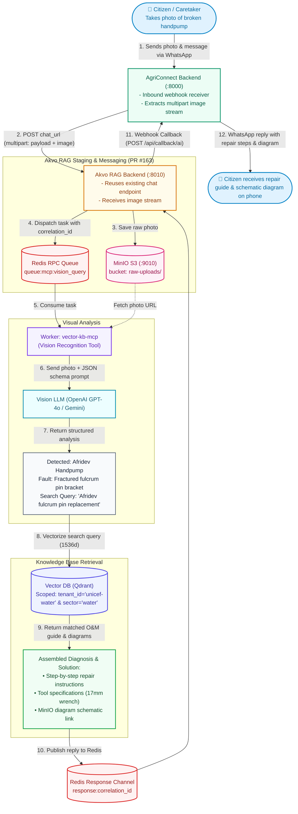
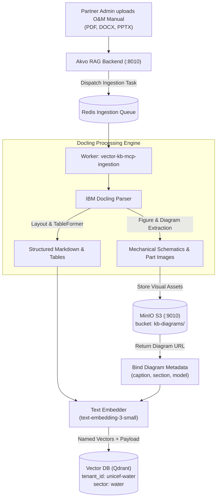
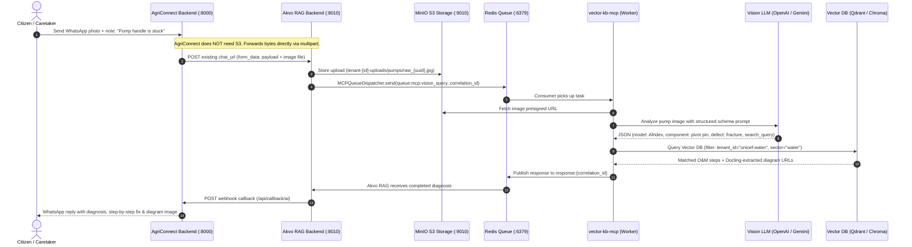

# Exploration Note: Akvo RAG Image Recognition Architecture & MCP Integration

> **Status:** Draft / Exploration Note  
> **Context:** AkvoConnect Phase 3 (Multi-Tenancy, Water/WASH Sector, Photo-Based Pump Diagnostics)  
> **Target Systems:** AgriConnect Backend & Akvo RAG Monorepo (aligned with PR #163)  
> **Author:** Engineering Team  

---

## 1. Executive Summary

In AkvoConnect Phase 3, one of the headline capabilities for the Water/WASH sector (partnered with UNICEF & WaterNet) is **photo-based pump diagnostics**. When rural water point caretakers encounter broken handpumps (e.g., Afridev or India Mark II), they frequently cannot describe the mechanical failure accurately through text alone.

### Key Architectural Decisions:
1. **Zero S3 Infrastructure in AgriConnect:** AgriConnect remains lightweight and stateless regarding permanent object storage. It simply forwards image bytes via `multipart/form-data` to the established `chat_url`. **Akvo RAG alone manages MinIO S3** for persistent storage and pre-signed URL generation.
2. **Reuse Existing Chat Endpoint:** No new endpoints (`/api/v1/query/image`) are introduced. AgriConnect uses the existing `chat_url` and callback webhook (`/api/callback/ai`).
3. **Alignment with PR #163:** Native monorepo integration utilizing `MCPQueueDispatcher`, Redis Request-Reply queues, MinIO S3 (:9010), and dedicated `vector-kb-mcp` worker services.
4. **Dual Image Lifecycle (Ingestion vs. Query):**
   - **Knowledge Base Images:** Sourced automatically via **Docling** from partner manuals (PDF/DOCX/PPTX) and cataloged into MinIO + Qdrant.
   - **Query Images:** Sent by citizens via WhatsApp, interpreted by a **Vision LLM** into structured diagnostic queries, and matched against the Docling-extracted knowledge base.

---

## 2. Complete Visual Workflow (Citizen-First Flowchart)

The following flowchart shows the end-to-end journey starting directly from **the citizen taking a photo of a broken pump** and following through to diagnostic retrieval:



---

### 2.2. Offline Background Ingestion: How Knowledge Base Diagrams are Created
This offline pipeline populates the multimodal Knowledge Base with technical diagrams before citizens ask questions:



---

## 3. End-to-End Sequence Diagram



---

## 4. Deep-Dive: Storage & Knowledge Base Strategy

### 4.1. Why AgriConnect Does Not Need S3
1. **Separation of Concerns:** AgriConnect handles channel routing, customer profiles, tickets, and officer assignment. Permanent media storage, chunking, and AI embeddings belong strictly inside Akvo RAG.
2. **Zero Infrastructure Duplication:** Akvo RAG already bundles MinIO S3 (:9010) in its Docker Compose setup (PR #163). Adding S3 to AgriConnect would duplicate AWS/MinIO credentials, bucket lifecycles, and storage sync logic.
3. **Stateless Forwarding:** AgriConnect receives media bytes from the WhatsApp/Meta webhook and streams them directly to Akvo RAG's `chat_url` via `httpx`.

### 4.2. How the Image Knowledge Base Works
The Knowledge Base for images is not built manually; it is constructed through two complementary ingestion mechanisms:

#### 1. Automatic Document Diagram Extraction (Docling)
- During partner manual upload (PDF/DOCX/PPTX), **Docling** extracts embedded mechanical schematics, part callouts, and repair flowcharts.
- Each extracted image is saved to MinIO (`kb-diagrams/{tenant_id}/{doc_id}/fig_{n}.png`).
- The image is paired with its surrounding text context (caption, section heading, parent paragraphs) and indexed in Qdrant with `tenant_id` metadata.

#### 2. Partner Spare Part Reference Catalog (Admin Upload)
- Partners (UNICEF, WaterNet) can optionally upload an image bank of certified spare parts and common failure modes (e.g., 50 sample photos of worn-out vs. new rubber seals).
- Stored as reference assets in MinIO and registered in the Knowledge Base table.

### 4.3. Retrieval Strategies: Text-Bridge vs. Direct Visual Matching

| Strategy | How it Works | Pros | Current Recommendation |
| :--- | :--- | :--- | :--- |
| **Strategy A: Text-Bridge Retrieval** | Vision LLM inspects citizen photo ➔ produces structured technical text query ➔ searches Docling-extracted text chunks and diagram URLs in Qdrant. | Highest semantic accuracy; handles fuzzy/dirty camera shots; explains *why* the part failed. | **Recommended for Phase 3** |
| **Strategy B: Multimodal Direct Vector Matching** | Citizen photo is embedded via CLIP/SigLIP ➔ searched directly against visual embeddings of reference images in Qdrant Named Vectors. | No LLM translation step needed. | Future enhancement (can run in parallel via Qdrant Named Vectors). |

---

## 5. Technical Specification: Payload & Endpoint Contract

### 5.1. AgriConnect ➔ Akvo RAG (`chat_url`)
AgriConnect calls the existing `chat_url` with multipart form data:

```python
# In backend/services/external_ai_service.py:
form_data = {
    "payload": json.dumps({
        "job": "chat",
        "prompt": prompt,
        "chats": [
            {
                "role": "user",
                "content": "Pump handle is stuck",
                "media": [{"type": "image", "filename": "broken_handle.jpg"}]
            }
        ],
        "callback_params": {
            "message_id": 1042,
            "customer_id": 55,
            "ticket_id": 312,
            "tenant_id": "unicef-water-kenya"
        }
    })
}
files = {"file": ("broken_handle.jpg", image_bytes, "image/jpeg")}

response = await client.post(self.token.chat_url, data=form_data, files=files, headers=headers)
```

### 5.2. Vision LLM Structured Prompt (Inside `vector-kb-mcp`)
```json
{
  "equipment_type": "Handpump",
  "detected_model": "Afridev",
  "component_identified": "Pump Handle & Fulcrum Pin Bracket",
  "visual_defect": "Fractured fulcrum bracket and displaced pivot bolt",
  "technical_search_intent": "Afridev handpump handle fulcrum pin replacement procedure bolt torque"
}
```

### 5.3. Callback Payload (Akvo RAG ➔ AgriConnect `/api/callback/ai`)
```json
{
  "job_id": "job-vision-88392",
  "status": "completed",
  "message_id": 1042,
  "customer_id": 55,
  "ticket_id": 312,
  "answer": "Based on your photo, the Afridev handpump handle bracket has a fracture on the fulcrum pin.\n\nRepair steps:\n1. Use a 17mm wrench to loosen the retaining bolts.\n2. Remove the handle and inspect bushing wear.\n3. Replace with a new fulcrum pin (Part #AF-04).",
  "media_references": [
    {
      "type": "diagram",
      "title": "Afridev Handle Assembly Diagram",
      "url": "https://storage.akvorag.org/kb-diagrams/unicef-water/afridev_manual_fig4.png"
    }
  ],
  "confidence_score": 0.92
}
```

---

## 6. Alignment with `akvo/akvo-rag` PR #163 Architecture

| Architecture Pillar (PR #163) | Integration Role in Image Recognition |
| :--- | :--- |
| **Monorepo Topology** | Lives inside the unified codebase alongside `backend`, `vector-kb-mcp`, and `frontend`. |
| **Redis RPC Queues** | Uses `MCPQueueDispatcher` for request-reply job dispatching (zero Celery overhead). |
| **Dual Workers** | Ingestion handled by `vector-kb-mcp-ingestion` (Docling parsing); runtime diagnostic queries handled by `vector-kb-mcp` (Vision + Vector retrieval). |
| **MinIO S3 Integration (:9010)** | Single authoritative store for both incoming citizen photos and Docling-extracted diagram schematics. |
| **PostgreSQL 17 (`asyncpg`)** | Stores job audit logs, multimodal prompt templates, and metadata indexes. |

---

## 7. Implementation Roadmap

1. **Phase 1: Ingestion Pipeline (Docling + MinIO)**
   - Implement figure and diagram cropping in `vector-kb-mcp-ingestion`.
   - Store cropped schematics in MinIO S3 and save reference metadata in Qdrant.
2. **Phase 2: Multipart Handling in Akvo RAG `chat_url`**
   - Extend the chat endpoint in Akvo RAG to accept optional file uploads and stage them to MinIO.
3. **Phase 3: Vision Recognition Tool in `vector-kb-mcp`**
   - Implement the `recognize_and_retrieve_manual` tool using OpenAI GPT-4o Vision structured output.
   - Wire tool output to Qdrant vector retrieval.
4. **Phase 4: End-to-End AgriConnect Verification**
   - Verify that citizen photos sent via WhatsApp trigger the entire pipeline and return diagnosis + diagram URLs via `/api/callback/ai`.
